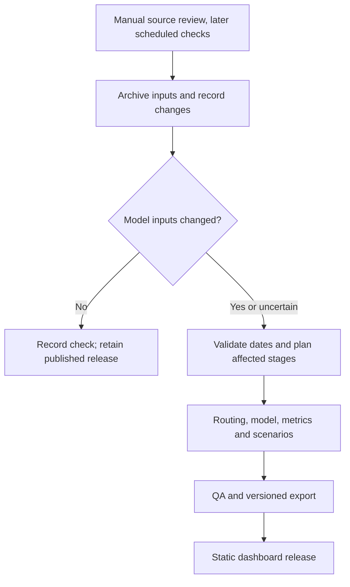

# Platform and Refresh Plan

Updated: 2026-09-23. Initial planning draft; implementation has not started.
The user accepted a lightweight refresh direction and requested planning.
Cadence, release metadata, and implementation phases below are proposals.

## Purpose

Grow the San Diego research dashboard into a U.S. transit accessibility and
uncertainty application through California pilots. Users should be able to inspect
a neighborhood, understand its uncertainty, compare supported scenarios, and see
which data and assumptions support a result.

Start with versioned, precomputed regional releases. A dated research snapshot
remains useful between releases; identify its analysis period instead of implying
that it describes today's service.

## Current Foundation and Gaps

Source inspection on 2026-09-23, following a Graphify query:

| Existing location | Reuse and work needed |
| --- | --- |
| `scripts/download_data.py` | Downloads sources and records provenance/hashes. Existing-file skipping is not remote change detection; `--force` replaces files, so archive versions before automating refreshes. |
| `notebooks/02_gtfs_processing.ipynb` through `07_intervention_simulation.ipynb` | Research workflow exists. Establish reproducible CLI stages using reusable code before scheduling. |
| `scripts/run_pipeline.py`, `scripts/run_model.py` | Both are empty placeholders. |
| `scripts/export_frontend.py` | Existing Python-to-app bridge; fixed San Diego paths, run ID, summary values, and latest-file selection need explicit release inputs and derived metadata. |
| `app/src/hooks/useGeoData.ts` | Loads static baseline, metadata, neighbors, and scenarios. Regional release selection is future work. |

`INTERFACES.md` describes existing contracts. Proposed fields here are not yet
implemented. Notebook completion does not establish unattended pipeline readiness;
F029's model-validation limitations still apply.

## What the Application Looks Like

Build on [dashboard visual research](DASHBOARD_VISUAL_RESEARCH.md):

- **Explore:** place search, region and published-release selectors, map layers
  for access, desert probability, and uncertainty; tract drawer with posterior
  distribution, threshold, population context, and source dates.
- **Compare:** baseline versus precomputed intervention with a shared legend,
  tract-level changes, and assumptions. Add historical comparison only after
  geography, thresholds, and model versions can be aligned.
- **Explain:** selected-tract evidence, modeled and excluded uncertainty sources,
  service period, provenance, and downloadable summaries.
- **Release state:** analysis window and publication date shown separately;
  partial coverage and historical-only data clearly marked. On mobile, use a
  tract sheet and keep controls reachable.

Offer only controls backed by outputs. Label parametric interventions as
hypothetical; physical route/timetable changes require routing experiments.
Missing data is not zero access. Stale feeds are not automatically represented
by wider Bayesian uncertainty.

## Smallest Architecture

Keep existing `configs/`, `src/`, `scripts/`, `data/`, and `artifacts/` boundaries.
Archive source versions under raw data; partition derived files by region and
release when needed. Preserve run bundles under `artifacts/logs/runs/` and source
licenses. For meaningful model runs, use project-local MLflow alongside portable
bundles: record inputs, config, seed, Git SHA, metrics, artifacts, and acceptance
or rejection. Tracking must not depend on a hosted service.

Parquet/GeoParquet files suffice initially. Add local DuckDB when large joins or
cross-release queries justify it; DuckDB does not schedule jobs, route trips, or
replace inference. It is free and MIT-licensed ([official FAQ](https://duckdb.org/faq)).
Add remote object storage for demonstrated sharing/retention needs and regional
or tiled map assets when measured payload/rendering costs require them.

## Refresh Policy

Census tracts are relatively permanent areas reviewed before decennial censuses,
but stable geography does not imply stable accessibility
([Census glossary](https://www.census.gov/programs-surveys/geography/about/glossary.html)).
GTFS publishing guidance asks for at least seven days of future validity and
preferably thirty; quarterly checks cannot guarantee continuously current coverage
([GTFS best practices](https://gtfs.org/documentation/schedule/schedule-best-practices/)).

| Input or event | Proposed review cadence | Recompute when |
| --- | --- | --- |
| GTFS | Quarterly for the snapshot product; ad hoc for known service redesigns | Stops, schedules, frequencies, transfers, calendars, or other consumed routing inputs change for the chosen analysis period. |
| ACS, jobs, destinations | Annual baseline review tied to available releases | Adopted covariates, opportunity counts, or destination locations change. |
| Tract boundaries, OSM | Annual review plus relevant known changes | Adopted geometry, origins, adjacency, or walk-network inputs change. |
| Model, config, thresholds, scenarios | Explicit versioned change | Dependent stages become invalid, even with identical source files. |

An annual review may reuse unchanged stages. The service date/window is itself
an input: validate calendars across agencies and use comparable day types/time
windows across releases. Historical snapshots retain their dates and limitations.

Use remote metadata as a download hint, then hashes and normalized comparisons
of fields consumed by routing. ZIP packaging changes alone need not rerun routing.
Review unclassified changes; initially recompute for every relevant input change
rather than inventing a percentage cutoff that could hide local service loss.
A failed fetch or expired calendar is a quality event, not "unchanged."

Demographic-only updates can reuse routing if origins, destinations, and network
are identical. Threshold-only changes can reuse sufficient stored posterior
outputs; new travel-time budgets may require routing. Refit the entire model unit
when shared parameters or spatial effects couple tracts. Account for connecting
agencies and cross-border trips; independent regional inference remains unproven.

## Releases and Verification

Propose a release manifest with release/region IDs, analysis date/window, source
versions/hashes/retrieval dates, geometry vintage, config/code/model versions,
threshold definition, run ID, validation/coverage status, publication date, and
output paths. Promote a complete validated export together. Failed runs retain
the preceding good release, its visible age, and a separate failure record.

Before publication, check service calendars, GEOID uniqueness/joins, geometry/CRS,
coverage/unreachable routes, finite metrics, probability bounds, interval ordering,
model diagnostics, and baseline/scenario compatibility. Spot-check routes and
investigate unexpected changes. Posterior uncertainty is conditional on model
assumptions; repeated simulation alone does not establish calibration. Historical
comparisons must separate service changes from model, threshold, or boundary changes.

## Delivery Sequence

| Phase | Deliverable | Completion evidence |
| --- | --- | --- |
| 1. Reproducible San Diego release | Explicit inputs, archived sources, derived export metadata, and a CLI path through required stages. | Reproducible release; no mixed old/new outputs on failure; recorded runtime, peak RAM, and output size. |
| 2. Refresh pilot | Manual change report, dependency-based rerun plan, visible release provenance. | Unchanged/packaging-only feeds skip routing; service changes rerun dependents; failed/expired feeds preserve the published release. |
| 3. California pilots | Second contrasting region, then representative regions in `SCOPE.md`; scalable inference calibrated against MCMC slices. | Cross-border coverage, uncertainty calibration, region switching, and per-region cost measured before statewide expansion. |
| 4. U.S. rollout | Expand audited regional workflow; add scheduling after successful manual refreshes. | Coverage gaps visible; runtime/storage budgets and frontend payload targets met. |

First implementation task to scope: **one versioned San Diego release with an
explicit input manifest and reproducible export**. Then test refresh decisions
on a small feed pair before statewide pulls. Add implementation tasks to
`TASKS.md` as scoped; existing California tasks remain draft.

## Deferred Choices and Cost

For inference alternatives and spatial scaling, read [MODELING_NOTES.md](MODELING_NOTES.md).
The initial shortlist is MCMC as a reference, VI/ADVI, and INLA, with posterior
probability/interval QA. No automatic switch to VI or NumPyro is decided.

Global coverage, live vehicle feeds, on-demand inference, a managed data lake,
and dedicated orchestration are outside the first release. Revisit for measured
operational limits or demonstrated user needs.

Measure routing/inference time, peak RAM, retained bytes, and dashboard transfer
size before cloud sizing. Earlier conversational dollar ranges are not validated
national budgets. Pilot selection, the public freshness promise, common threshold
policy, spatial model partitions, and hosting budget remain open.

## Keeping Context Current

After each milestone: revise this plan for direction changes, record decisions in
`DECISIONS.md`, task evidence in `TASKS.md`, and current/next work in `STATUS.md`
and `HANDOVER.md`. Update `INTERFACES.md` when contracts are implemented and
`structure.md` when files/artifacts exist. Distinguish proposals from completed work.
